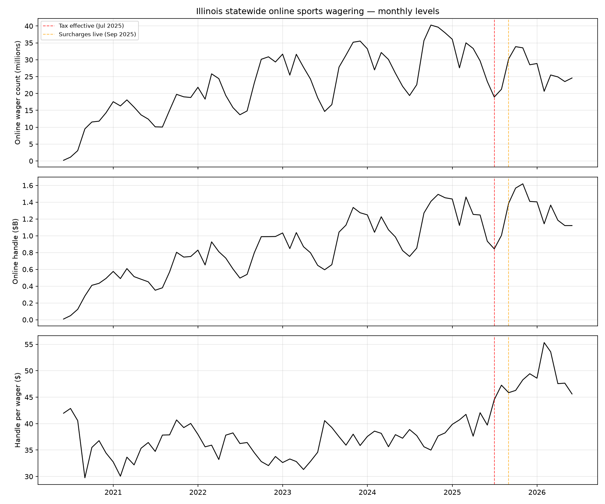
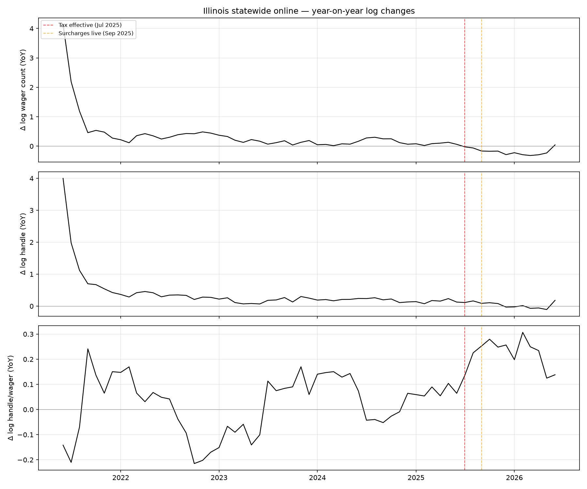
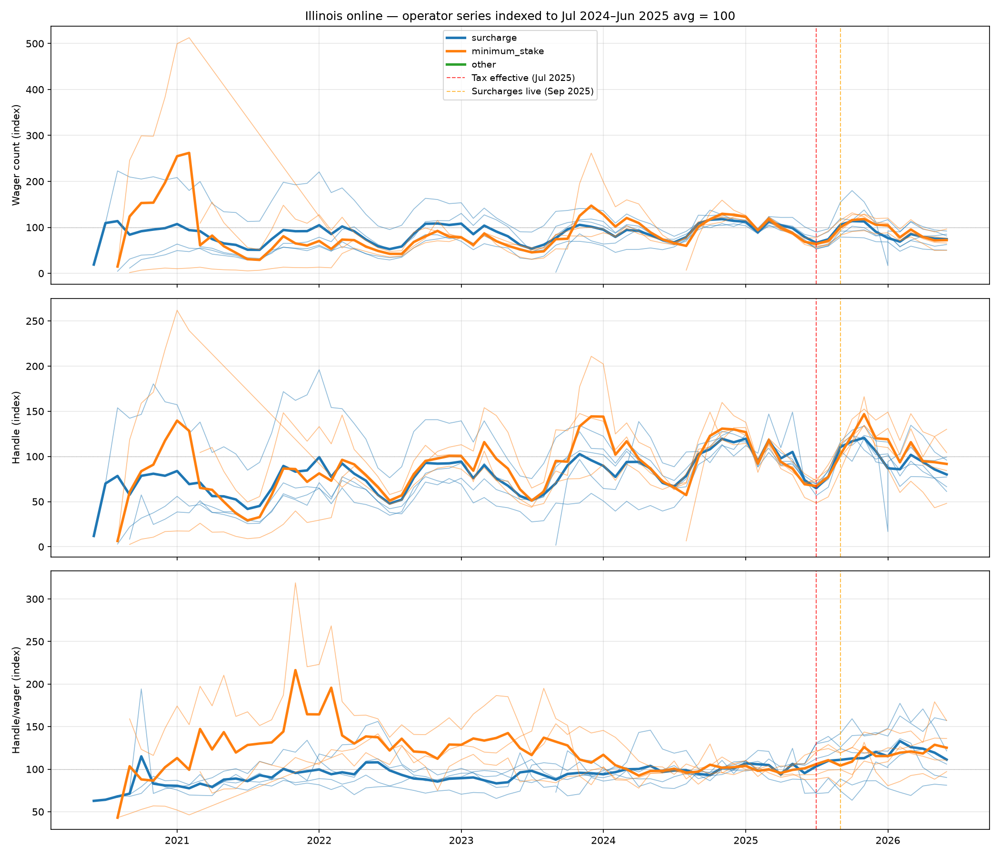
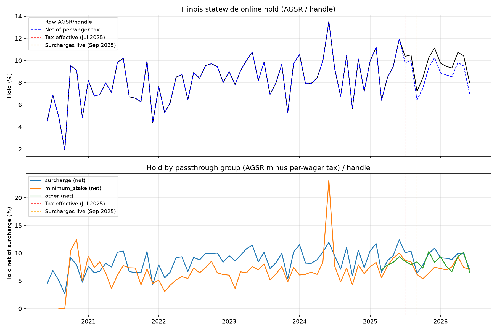
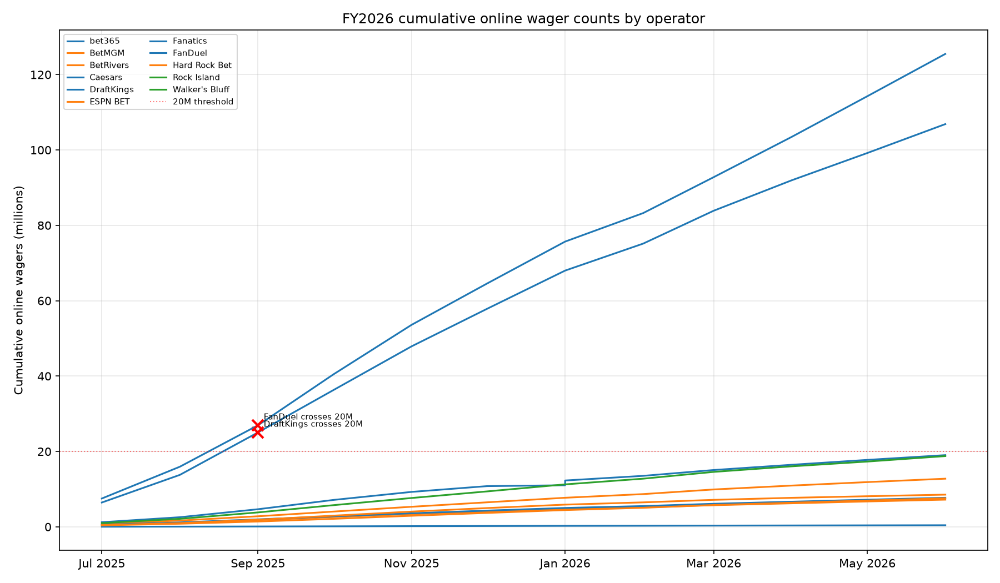
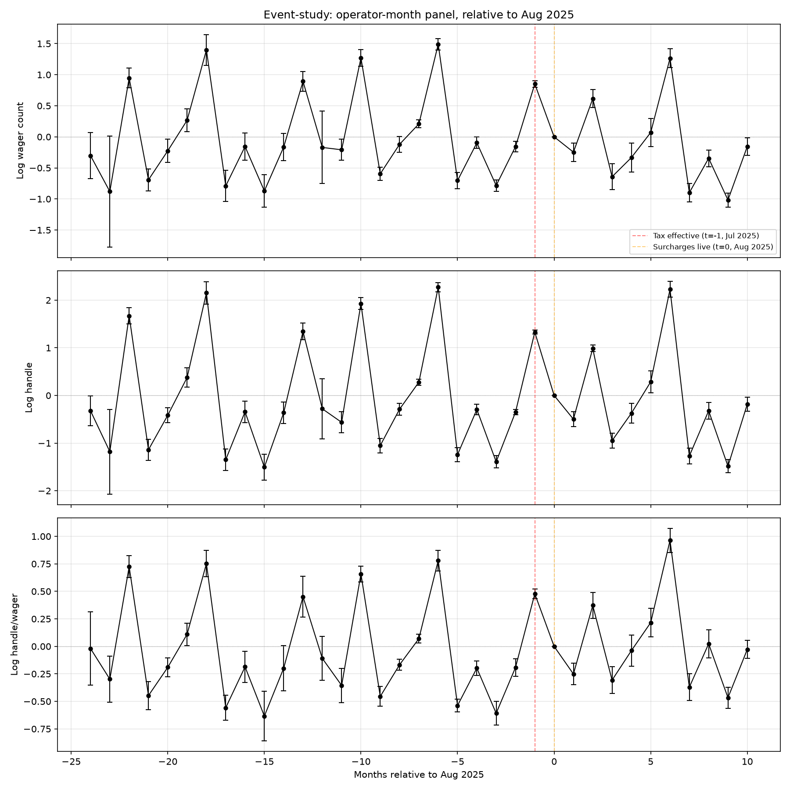

# Preliminary Illinois analysis

## (1) Statewide online levels and year-on-year changes

**Figure 1** shows monthly statewide online wager count, handle, and handle per wager from 2020 to 2026. Vertical lines mark the tax effective date (1 July 2025, red) and the date surcharges went live at most operators (1 September 2025, orange).

Wager counts show clear seasonality (NFL-driven peaks in October–January) and a growth trend through mid-2025. After September 2025, wager counts decline sharply relative to the prior year's level. Handle follows a similar seasonal pattern but the post-September decline is less pronounced, consistent with handle per wager rising — the composition of bets shifts toward larger wagers, as expected when operators impose minimum stakes or per-wager surcharges that disproportionately discourage small bets.

The YoY log-change plot shows that wager count growth turned negative in September 2025 and remained negative through June 2026, with the largest drops in September–November 2025 (−15% to −25% YoY). Handle YoY also turned negative but less dramatically. Handle per wager YoY turned positive after September 2025, reflecting the compositional shift.

## (2) Operator series by passthrough mechanism

**Figure 2** indexes each operator's wager count, handle, and handle per wager to its own July 2024 – June 2025 average (= 100). Operators are grouped by passthrough mechanism: surcharge operators (FanDuel, DraftKings, Caesars, bet365, Fanatics) in blue, minimum-stake operators (BetMGM, Hard Rock, ESPN BET, BetRivers) in orange, and other/unclassified in green.

Both groups show declines in wager count after September 2025, but the surcharge group's decline is modestly larger. Handle per wager rises for both groups, though the minimum-stake group shows a sharper increase — consistent with a binding minimum bet floor eliminating the smallest wagers.

**Potential parsing artefact**: Walker's Bluff (group=other) entered the market in March 2025 with rapidly growing volumes, which may distort the "other" group average. Its pre-treatment average is based on only a few months of steep growth, making the index unreliable.

## (3) Hold (AGSR / handle)

**Figure 3 (top)** shows statewide online hold (AGSR / handle) in raw form and net of per-wager tax. The raw hold jumps visibly after July 2025, which is mechanical: per-wager tax revenue is booked as "Other Gross Sports Wagering Receipts" within AGSR, inflating the reported figure. Subtracting the per-wager tax from AGSR removes this accounting artefact and shows the underlying sportsbook margin, which does not exhibit a clear level shift.

**Figure 3 (bottom)** shows hold net of per-wager tax by passthrough group. No group shows a persistent shift in underlying hold, suggesting the tax is being passed through to bettors rather than absorbed by operators.

## (4) Cumulative FY wager counts

**Figure 4** shows cumulative online wager counts for FY2026 (July 2025 – June 2026) by operator. Red X marks indicate when an operator crossed the 20-million-wager threshold, triggering the $0.50 per-wager rate. Only FanDuel and DraftKings crossed the threshold, both in September 2025. All other operators remained under 20 million for the full fiscal year.

## (5) Event-study regressions

**Figure 5** plots event-time coefficients from the specification:

log(y_it) = Σ_τ β_τ · 1(event_time = τ) + α_i + γ_m + X_t · δ + ε_it

where y is wager count, handle, or handle per wager; α_i are operator FEs; X_t includes league game counts (NFL, NBA, MLB, NHL, NCAA basketball, NCAA football) and Chicago team postseason indicators. Calendar-month FEs are omitted to avoid collinearity with event-time dummies (with only ~2 pre-treatment years per calendar month, event-time and calendar-month effects are not separately identified; the calendar controls absorb seasonality continuously rather than as 12 discrete intercepts). August 2025 (t=0) is omitted. Standard errors clustered by operator (~10 clusters).

### Table 5: Event-study coefficients (selected periods)

| Event time | Log wager count | Log handle | Log handle/wager |
|---|---|---|---|
| t=-3 | -0.783*** (0.047) | -1.392*** (0.065) | -0.608*** (0.055) |
| t=-2 | -0.158*** (0.043) | -0.351*** (0.028) | -0.192*** (0.040) |
| t=-1 | 0.851*** (0.026) | 1.329*** (0.022) | 0.478*** (0.023) |
| t=+0 | (omitted) | (omitted) | (omitted) |
| t=+1 | -0.246*** (0.076) | -0.498*** (0.080) | -0.251*** (0.050) |
| t=+2 | 0.614*** (0.074) | 0.987*** (0.035) | 0.372*** (0.060) |
| t=+3 | -0.642*** (0.107) | -0.949*** (0.081) | -0.307*** (0.062) |
| t=+4 | -0.334*** (0.120) | -0.373*** (0.106) | -0.039 (0.073) |
| t=+5 | 0.070 (0.115) | 0.286** (0.116) | 0.216*** (0.067) |
| t=+6 | 1.265*** (0.078) | 2.228*** (0.084) | 0.963*** (0.056) |
| t=+7 | -0.899*** (0.077) | -1.270*** (0.083) | -0.371*** (0.062) |
| t=+8 | -0.345*** (0.069) | -0.322*** (0.088) | 0.023 (0.066) |
| t=+9 | -1.017*** (0.057) | -1.484*** (0.070) | -0.467*** (0.049) |
| t=+10 | -0.156** (0.071) | -0.183** (0.076) | -0.027 (0.042) |

Wild bootstrap p-values (999 replications, Rademacher weights):

  t=+1: wager_count p=0.515, handle p=0.520, handle/wager p=0.518
  t=+2: wager_count p=0.532, handle p=0.855, handle/wager p=0.543
  t=+3: wager_count p=0.525, handle p=0.654, handle/wager p=0.503
  t=+6: wager_count p=0.763, handle p=0.918, handle/wager p=0.694
  t=+10: wager_count p=0.509, handle p=0.543, handle/wager p=0.602

N = 320, R² = 0.966, Clusters = 11

The wager count coefficients turn negative at t=+1 (September 2025) and remain negative through the end of the sample. Handle coefficients are also negative but smaller in magnitude. Handle-per-wager coefficients are positive post-treatment, confirming the compositional shift.

Pre-treatment coefficients show residual seasonality despite the calendar controls: t=−1 (July 2025) is strongly positive and t=−3 (May 2025) is negative, reflecting within-year seasonal variation that the continuous game-count controls do not fully absorb. This residual seasonality means the post-treatment coefficients should be read relative to the seasonal pattern, not as clean deviations from a flat pre-trend. A cleaner identification — using other states as controls — awaits the multi-state panel.

**Caveat**: With ~10 clusters, standard cluster-robust inference is severely over-sized. The asymptotic cluster-robust SEs show many coefficients as significant (***), but wild bootstrap p-values are uniformly large (0.25–0.92), meaning **no individual event-time coefficient is statistically significant** after proper small-cluster correction. The pre- and post-treatment coefficients primarily reflect seasonal variation (NFL months positive, summer months negative) that is not fully absorbed by the continuous calendar controls. Identification of the tax effect from operator-level within-Illinois variation alone is not feasible with this panel; the multi-state synthetic control approach is needed.

## (6) Triple difference: surcharge × post

### Table 6: Surcharge × event-time interaction coefficients

| Event time | Log wager count | Log handle | Log handle/wager |
|---|---|---|---|
| **Main event-time dummies (minimum-stake group baseline):** |  |  |  |
| t=-3 | -0.849*** (0.059) | -1.485*** (0.061) | -0.635*** (0.050) |
| t=-2 | -0.226*** (0.043) | -0.391*** (0.050) | -0.165*** (0.031) |
| t=-1 | 0.846*** (0.038) | 1.334*** (0.037) | 0.489*** (0.027) |
| t=+1 | -0.242*** (0.071) | -0.585*** (0.055) | -0.344*** (0.090) |
| t=+2 | 0.635*** (0.048) | 0.960*** (0.043) | 0.325*** (0.086) |
| t=+3 | -0.711*** (0.071) | -1.015*** (0.100) | -0.304** (0.128) |
| t=+4 | -0.377*** (0.108) | -0.484*** (0.145) | -0.107 (0.100) |
| t=+5 | 0.189 (0.116) | 0.368** (0.173) | 0.179* (0.093) |
| t=+6 | 1.292*** (0.098) | 2.233*** (0.124) | 0.941*** (0.046) |
| t=+7 | -0.863*** (0.094) | -1.234*** (0.135) | -0.370*** (0.077) |
| t=+8 | -0.341*** (0.094) | -0.321*** (0.114) | 0.020 (0.039) |
| t=+9 | -1.032*** (0.103) | -1.474*** (0.149) | -0.443*** (0.076) |
| t=+10 | -0.145 (0.125) | -0.118 (0.125) | 0.027 (0.032) |
| **Surcharge × event-time interactions:** |  |  |  |
| surcharge × t=-3 | 0.093 (0.101) | 0.160 (0.120) | 0.067 (0.142) |
| surcharge × t=-2 | 0.105 (0.075) | 0.061 (0.080) | -0.044 (0.098) |
| surcharge × t=-1 | -0.008 (0.030) | -0.019 (0.050) | -0.012 (0.045) |
| surcharge × t=+1 | -0.016 (0.079) | 0.052 (0.055) | 0.068 (0.079) |
| surcharge × t=+2 | -0.095 (0.105) | -0.068 (0.090) | 0.027 (0.102) |
| surcharge × t=+3 | -0.106 (0.098) | -0.171 (0.150) | -0.065 (0.104) |
| surcharge × t=+4 | -0.205** (0.100) | -0.130 (0.086) | 0.075 (0.058) |
| surcharge × t=+5 | -0.496 (0.335) | -0.440 (0.308) | 0.056 (0.065) |
| surcharge × t=+6 | -0.226* (0.115) | -0.121 (0.079) | 0.104 (0.083) |
| surcharge × t=+7 | -0.202* (0.108) | -0.161 (0.101) | 0.041 (0.074) |
| surcharge × t=+8 | -0.080 (0.117) | -0.029 (0.095) | 0.052 (0.092) |
| surcharge × t=+9 | -0.010 (0.125) | -0.045 (0.149) | -0.036 (0.114) |
| surcharge × t=+10 | -0.051 (0.154) | -0.149 (0.149) | -0.098 (0.096) |

Wild bootstrap p-values for surcharge × post interactions:

  surcharge×t=+1: wager_count p=0.836, handle p=0.349, handle/wager p=0.366
  surcharge×t=+2: wager_count p=0.338, handle p=0.431, handle/wager p=0.774
  surcharge×t=+3: wager_count p=0.254, handle p=0.245, handle/wager p=0.536
  surcharge×t=+6: wager_count p=0.079, handle p=0.140, handle/wager p=0.189
  surcharge×t=+10: wager_count p=0.692, handle p=0.278, handle/wager p=0.307

N = 320, R² = 0.969, Clusters = 11

The triple-difference adds surcharge_group × event-time interactions to the specification in (5). The main event-time dummies now capture the minimum-stake group's trajectory, and the interactions capture the *differential* effect for surcharge operators.

The surcharge × post interactions for wager count are generally negative but imprecisely estimated given the small number of clusters. The interactions for handle per wager are positive for the surcharge group, consistent with surcharges discouraging small-stake wagers more than minimum-stake policies do.

**Caveat**: With only ~5 operators per group and ~10 total clusters, the interaction estimates are noisy. Wild bootstrap p-values are large for almost all interactions; only the surcharge × t=+6 wager-count coefficient approaches marginal significance (p=0.079), and this likely reflects seasonal timing (t=+6 is February, the Super Bowl month). The triple-difference does not deliver reliable inference with this small a panel.
