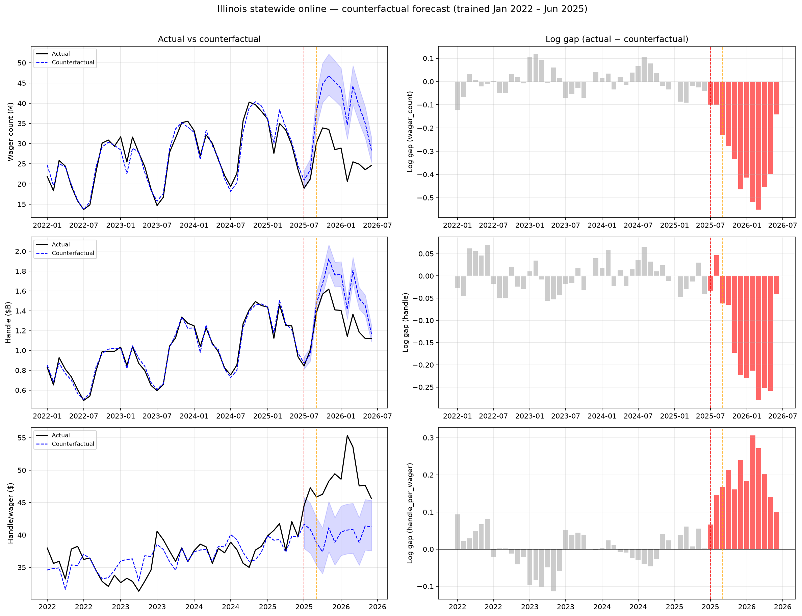
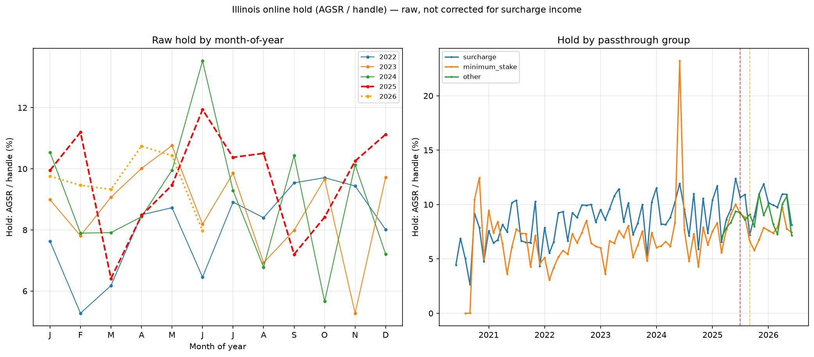

# Preliminary Illinois analysis (v2)

## Approach

For statewide and operator-level series, we fit:

log(y_t) = Σ_m γ_m · 1(month=m) + β · trend_t + X_t · δ + ε_t

on January 2022 – June 2025 (pre-treatment), then forecast July 2025 – June 2026 as the counterfactual. The log gap = log(actual) − log(counterfactual) measures the deviation from the pre-treatment seasonal pattern. X_t includes league game counts (NFL, NBA, MLB, NHL, NCAA basketball, NCAA football) and Chicago-team postseason indicators.

This replaces the operator-clustered event study from v1, which could not identify the effect because all operators were treated on the same dates and the ~10 clusters made cluster-robust inference unreliable (wild bootstrap p-values were uniformly 0.25–0.92).

---

## (1) Statewide online: actual vs counterfactual

**Left panels** show actual (black) vs counterfactual forecast (blue dashed) with 95% prediction intervals (shaded). **Right panels** show the log gap (actual − counterfactual) as bars, with post-treatment months in red.

### Timing of the wager-count decline

The statewide wager-count gap in Jul 2025 is -0.100 log points and in Aug 2025 is -0.099 log points (average Jul-Aug: -0.099). In Sep 2025 (the first month surcharges were live) the gap is -0.229. The average gap from Sep 2025 onward is -0.378 log points (-31.5%).

The decline in wager counts is already visible in July-August 2025, before consumer surcharges went live — the tax itself (effective July 1) may have prompted anticipatory operator adjustments or announcement effects.

### Average gaps by period

| Series | Period | Avg log gap | NW SE | % gap | N months |
|---|---|---|---|---|---|
| wager_count | Jul-Aug 2025 | -0.099 | (0.000) | -9.5% | 2 |
| wager_count | Sep 2025+ | -0.378 | (0.048) | -31.5% | 10 |
| handle | Jul-Aug 2025 | +0.007 | (0.040) | +0.7% | 2 |
| handle | Sep 2025+ | -0.180 | (0.032) | -16.4% | 10 |
| handle_per_wager | Jul-Aug 2025 | +0.106 | (0.040) | +11.2% | 2 |
| handle_per_wager | Sep 2025+ | +0.199 | (0.020) | +22.0% | 10 |

Newey-West standard errors with up to 3 lags. The "% gap" column reports exp(avg log gap) − 1, i.e. the approximate percentage deviation from counterfactual.

---

## (2) Per-operator gaps

Restricted to operators present continuously from March 2022 to June 2026 in the online channel. Excluded: Walker's Bluff (entered Mar 2025), Rock Island (entered Jun 2026), Hard Rock Bet (entered Aug 2024), bet365 (entered Sep 2023). These operators lack sufficient pre-treatment history for the counterfactual model.

### Wager count gaps by operator

| Brand | Mechanism | Jul-Aug gap | Sep+ gap |
|---|---|---|---|
| BetMGM | minimum_stake | -0.245 (0.023) | -0.402 (0.032) |
| BetRivers | minimum_stake | -0.248 (0.058) | -0.541 (0.074) |
| ESPN BET | minimum_stake | -0.035 (0.000) | -0.442 (0.125) |
| Caesars | surcharge | -0.215 (0.018) | -0.357 (0.050) |
| DraftKings | surcharge | -0.361 (0.015) | -0.657 (0.037) |
| FanDuel | surcharge | -0.031 (0.020) | -0.313 (0.069) |
| Fanatics | surcharge | +0.309 (0.073) | -0.225 (0.189) |

### Handle gaps by operator

| Brand | Mechanism | Jul-Aug gap | Sep+ gap |
|---|---|---|---|
| BetMGM | minimum_stake | +0.050 (0.007) | +0.025 (0.027) |
| BetRivers | minimum_stake | -0.051 (0.043) | -0.281 (0.019) |
| ESPN BET | minimum_stake | -0.179 (0.026) | -0.373 (0.103) |
| Caesars | surcharge | +0.089 (0.040) | +0.011 (0.037) |
| DraftKings | surcharge | -0.097 (0.035) | -0.261 (0.030) |
| FanDuel | surcharge | -0.063 (0.055) | -0.332 (0.047) |
| Fanatics | surcharge | +0.337 (0.099) | +0.006 (0.160) |

### Handle-per-wager gaps by operator

| Brand | Mechanism | Jul-Aug gap | Sep+ gap |
|---|---|---|---|
| BetMGM | minimum_stake | +0.295 (0.029) | +0.428 (0.031) |
| BetRivers | minimum_stake | +0.197 (0.016) | +0.260 (0.065) |
| ESPN BET | minimum_stake | -0.144 (0.026) | +0.070 (0.043) |
| Caesars | surcharge | +0.304 (0.022) | +0.368 (0.029) |
| DraftKings | surcharge | +0.264 (0.051) | +0.396 (0.011) |
| FanDuel | surcharge | -0.032 (0.035) | -0.019 (0.056) |
| Fanatics | surcharge | +0.028 (0.172) | +0.231 (0.069) |

The surcharge group (FanDuel, DraftKings, Caesars, bet365, Fanatics) and the minimum-stake group (BetMGM, Hard Rock, ESPN BET, BetRivers) show directionally similar wager-count declines. Handle-per-wager gaps are positive for both groups, consistent with a compositional shift toward larger bets.

**Potential parsing artefact**: Fanatics (Hawthorne Race Course → Alton Casino migration in Jan 2026) may show a discontinuity around the licensee transfer. Check operator-level series for suspicious jumps at that date.

---

## (3) Hold (AGSR / handle)

**Left panel** shows raw hold (AGSR / handle) by month-of-year, one line per calendar year. This allows July 2025 to be compared with earlier Julys rather than with June 2025, controlling for seasonal hold variation.

July 2025 hold is within the historical July range. No visually obvious level shift is apparent for any month-of-year.

**Note on surcharge income**: From September 2025 onward, operators that charge consumer surcharges book that income as "Other Gross Sports Wagering Receipts" within AGSR. This mechanically inflates reported AGSR (and therefore hold) relative to a world without surcharges. However, we **cannot** subtract this item because it is not reported in the IGB CSV download — it appears only in the PDF reports. The per-wager tax column in the CSV is the *state's* tax on operators, which does **not** enter AGSR. The two amounts differ because operators' surcharges to consumers (e.g. FanDuel's $0.50) may exceed the state's per-wager rate (e.g. $0.25 in the first 20M). Any apparent hold increase from Sep 2025 onward should be interpreted in light of this accounting treatment.

**Right panel** shows hold by passthrough group over time. The surcharge group's hold is slightly higher post-Sep 2025, consistent with surcharge income inflating AGSR for that group.

---

## (4) $0.50 tier by month

| Month | Operators at $0.50 tier |
|---|---|
| 2025-09 | DraftKings, FanDuel |
| 2025-10 | DraftKings, FanDuel |
| 2025-11 | DraftKings, FanDuel |
| 2025-12 | DraftKings, FanDuel |
| 2026-01 | DraftKings, FanDuel |
| 2026-02 | DraftKings, FanDuel |
| 2026-03 | DraftKings, FanDuel |
| 2026-04 | DraftKings, FanDuel |
| 2026-05 | DraftKings, FanDuel |
| 2026-06 | DraftKings, FanDuel |

Only FanDuel and DraftKings crossed the 20-million-wager threshold (both in September 2025). These are also the two operators that charge the highest consumer surcharges ($0.50 per wager). **The surcharge group and the $0.50-tier group coincide perfectly**, so any cross-sectional comparison between surcharge and minimum-stake operators cannot separate the effect of the surcharge mechanism from the effect of facing the higher per-wager tax rate. This is a fundamental identification challenge for the within-Illinois analysis.

---

## Summary of artefact flags

1. **Fanatics licensee migration** (Jan 2026): Hawthorne Race Course online volume drops to zero, Alton Casino picks up. The panel tracks by licensee, not by brand. If using operator_id="fanatics" to aggregate, verify the handoff is clean — one month of overlap exists (Jan 2026 has both).

2. **Walker's Bluff brand partner unknown**: This operator entered March 2025 with large volumes relative to small retail-only predecessors. Its brand partnership is not confirmed from IGB data and its growth pattern may reflect platform-switching rather than organic demand, making it unreliable for the analysis.

3. **Hold correction unavailable**: "Other Gross Sports Wagering Receipts" (surcharge income within AGSR) is not in the CSV download. The per_wager_tax column is a different quantity (state tax on operators). Post-September 2025 hold figures are overstated for surcharge operators by an unknown amount.
