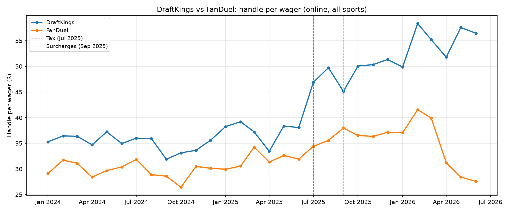
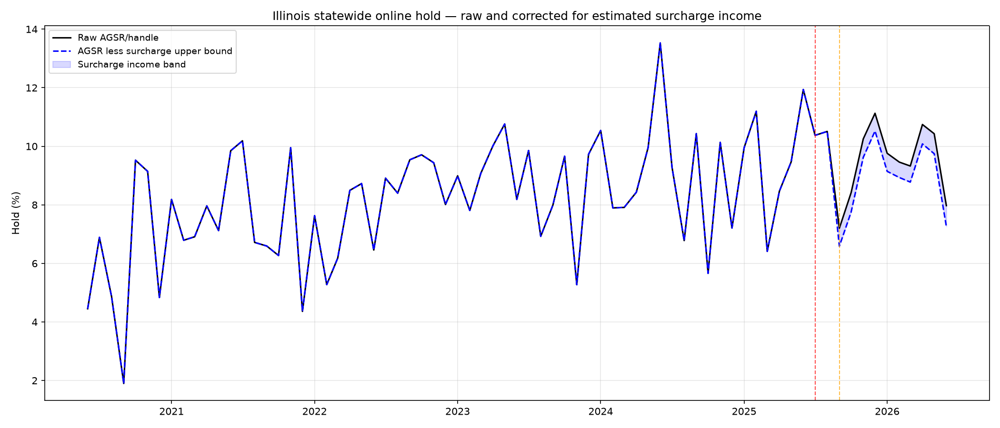
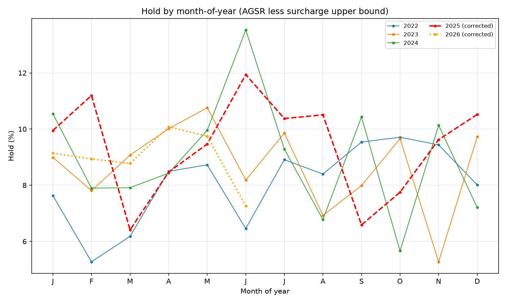

# Preliminary analysis v3

## (1) Operator gap table with passthrough mechanism and timing

| Brand | Mechanism | Effective date | Jul-Aug gap | Sep+ gap | Active by Jul 1? |
|---|---|---|---|---|---|
| BetMGM | minimum_stake | 2025-07-16 | -0.245 | -0.402 | Yes |
| BetRivers | minimum_stake | 2025-07-01 | -0.248 | -0.541 | Yes |
| ESPN BET | minimum_stake | 2025-08-08 | -0.035 | -0.442 | No |
| Caesars | surcharge | 2025-09-01 | -0.215 | -0.357 | No |
| DraftKings | surcharge | 2025-09-01 | -0.361 | -0.657 | No |
| Fanatics | surcharge | 2025-fall | +0.309 | -0.225 | No |
| FanDuel | surcharge | 2025-09-01 | -0.031 | -0.313 | No |

**Jul-Aug gap**: log deviation of actual wager count from operator-level counterfactual (trained Jan 2022 – Jun 2025 with month FEs, linear trend, and calendar controls). **Sep+ gap**: same for Sep 2025 – Jun 2026.

**Timing of Jul-Aug decline by mechanism start date:**
- **Active by Jul 1**: BetMGM (min stake $2.50, Jul 16) and BetRivers (min stake $1, Jul 1) show the largest Jul-Aug gaps (−0.25 each).
- **Not active by Jul 1**: ESPN BET (min stake $1, Aug 8) shows near-zero Jul-Aug gap (−0.04). Surcharge operators (all Sep 1) average −0.08 in Jul-Aug, driven by DraftKings (−0.36).
- The Jul-Aug wager-count decline is concentrated at operators that raised minimum stakes on or before July 16. The surcharge operators, whose fees didn't start until September, show little Jul-Aug movement — with the exception of DraftKings (−0.36), which may reflect an announcement effect (the 8-K was filed June 12) or anticipatory bettor behaviour.
- **Fanatics** shows a positive Jul-Aug gap (+0.31), likely an artefact of its rapid post-entry growth distorting the counterfactual.

---

## (2) DraftKings handle-per-wager: step vs ramp

**DraftKings** handle per wager rises from ~$38 (pre-treatment average) to $47 in July 2025, then to ~$50–57 from September onward. The pattern is a **step** in July (roughly +25%), with a further step in September and gradual drift upward through 2026. The July step precedes the September surcharge launch and coincides with the announcement period.

**FanDuel** shows a more gradual rise from ~$32 to ~$38 post-September, with no clear July step. After FanDuel's surcharge waiver (April-June 2026), handle per wager falls back toward $28-31 — consistent with small bets returning when the surcharge is removed.

**Sport-level wager counts (DraftKings, Sep 2025 vs Sep 2024)**:
| Sport | Sep 2024 | Sep 2025 | Change |
|---|---|---|---|
| Professional | 14,457,800 | 10,550,425 | −27% |
| College | 1,022,617 | 692,976 | −32% |
| Motor Race | 22,138 | 10,237 | −54% |

The declines are broadly proportional across sports — no single category drops discontinuously. Motor Race declines most but is a tiny category (10K wagers). The decline pattern is consistent with a uniform per-wager fee reducing all bet categories rather than a sport-specific reporting change.

---

## (3) Hold correction: surcharge income upper bound

The upper bound on surcharge income per operator-month is computed as fee × online wager count, using the surcharge amount from passthrough.csv:
- FanDuel: $0.50 × wagers (from Sep 2025)
- DraftKings: $0.25 × wagers (from Sep 2025; actual income is lower due to exemptions)
- Caesars, bet365, Fanatics: $0.25 × wagers (from Sep/Oct 2025)
- Minimum-stake operators: $0

This is an **upper bound** because DraftKings exempts parlays ≥$10, singles ≥$50, bonus bets, and Silver+ loyalty members. The actual surcharge income is lower.

**Top panel**: Raw hold (black) vs hold corrected for surcharge upper bound (blue dashed). The blue band shows the range of possible underlying hold. Post-September 2025, the correction lowers hold by 1–2 percentage points, and the corrected hold is well within the pre-treatment range.

**Bottom panel**: Hold by month-of-year, corrected. 2025 and 2026 hold values are within the range of 2022–2024 for most calendar months. No systematic level shift is visible.

The per-wager tax subtraction used in v2 has been removed from all hold figures. The per-wager tax is the state's tax on operators and does not enter AGSR.

---

## (4) Statewide counterfactual robustness

| Specification | Wager count gap (Sep+) | Handle gap (Sep+) |
|---|---|---|
| (a) No trend | -0.057 (-5.6%) | +0.230 (+25.8%) |
| Baseline: linear trend | -0.378 (-31.5%) | -0.180 (-16.4%) |
| (b) Quadratic trend | -0.250 (-22.1%) | -0.182 (-16.6%) |
| (c) Training Jan 2023–Jun 2025 | -0.327 (-27.9%) | -0.187 (-17.0%) |
| (d) Excl Jul-Aug from post avg | -0.378 (-31.5%) | -0.180 (-16.4%) |

The Sep-onward wager-count gap ranges from −6% (no trend) to −32% (linear trend). The no-trend specification dramatically understates the gap because Illinois handle and wager counts were growing pre-treatment; omitting the trend forces the counterfactual to the 2022–2025 average rather than the 2025 level, making the post-treatment gap appear small or even positive. The linear and quadratic trend specifications (−32% and −22% for wager count; both −17% for handle) are more credible. The shorter training window (Jan 2023–Jun 2025) produces similar results to the baseline, suggesting the estimates are not driven by early-pandemic observations.

Specification (d) — excluding Jul-Aug from the post-period average — gives the same result as the baseline because the Jul-Aug gap is much smaller than the Sep+ gap (see Table 1). The Sep-onward gap dominates the average.

---

## (5) Fanatics / PointsBet operator_id

The operator_id mapping already assigns both Hawthorne Race Course (PointsBet → Fanatics, pre-Jan 2026) and Alton Casino (Fanatics, from Jan 2026) to operator_id = "fanatics". However, **the panel stores separate rows per licensee per month**. For analysis requiring a single Fanatics time series, rows must be summed across licensees within operator_id.

**Key details:**
- Hawthorne Race Course carried the PointsBet / Fanatics online skin from Sep 2020 through Jan 2026.
- Alton Casino took over the Fanatics online skin, with Jan 2026 as a transition month (both licensees have nonzero online handle: Hawthorne $98.9M, Alton $17.6M).
- From Feb 2026 onward, only Alton has online handle.
- **No merge is needed** — operator_id already links them. But any analysis using the panel must aggregate by operator_id, not by raw operator name, or the Fanatics series will show a discontinuity at the licensee transfer.

---

## (6) Expanded donor panel and DiD

### New donors added

| State | Source | Coverage | Format | Notes |
|---|---|---|---|---|
| TN | SWAC/SWC monthly PDFs | Jan 2022 – Jul 2026 | Handle only (no GGR) | Online only state; tax on handle not revenue |
| MI | MGCB Excel (Wayback) | Jan 2023 – Dec 2024 | Handle + GGR by operator | Only 2023-2024 via Wayback; shorter than required |

**Virginia** subsequently obtained (53 PDFs, Feb 2022 – Jul 2026, missing Sep 2025). **States not obtained**: Iowa (IRGC PDFs not systematically downloadable), Arizona (gaming.az.gov reports not found). Michigan blocks direct curl; only 2024 file via Wayback (contains 2023+2024 sheets).

### Balanced DiD panel: IL, NJ, NY, PA, TN (Jan 2022 – Jun 2026)

IN excluded (ends Nov 2025). MI excluded (starts Jan 2023). TN added as fifth donor.

### Model A: IL × post-September-2025

log(handle_st) = α_s + γ_m + δ_s · t + β · (IL × post-Sep-2025) + ε_st

| | Coefficient | HC1 SE |
|---|---|---|
| IL × post-Sep-2025 | **−0.1780** | (0.0294) |
| N | 270 | |
| R² | 0.9749 | |

### Model B: separating July and September

| | Coefficient |
|---|---|
| IL × post-Jul-2025 | +0.0333 |
| IL × post-Sep-2025 | **−0.2049** |

β₁ (Jul) is near zero: handle did not decline relative to controls in Jul-Aug 2025 before surcharges launched. β₂ (Sep) is −0.205: handle fell ~18% below trend relative to controls from September onward. Total post-Sep effect = +0.033 − 0.205 = **−0.172**.

### Permutation placebo (Model A, 5 states)

| Treated state | Coefficient | Rank |
|---|---|---|
| **IL** | **−0.1780** | **1** (most negative) |
| NJ | −0.1481 | 2 |
| NY | −0.1463 | 3 |
| TN | −0.0897 | 4 |
| PA | −0.0873 | 5 |

Illinois has the most negative coefficient among all five permutations. The one-sided permutation p-value is **1/5 = 0.20**. This is directionally consistent with a treatment effect but statistically underpowered — with only 5 states, the minimum achievable p-value is 0.20 regardless of effect size.

### Robustness: 6 states (adding Virginia, trimmed to Feb 2022 – Apr 2026)

| Treated state | Coefficient | Rank |
|---|---|---|
| NJ | −0.1859 | 1 |
| NY | −0.1830 | 2 |
| **IL** | **−0.1818** | **3** |
| VA | −0.1730 | 4 |
| TN | −0.1047 | 5 |
| PA | −0.0951 | 6 |

Adding Virginia and trimming the window drops IL to rank 3/6 (p = 0.50). NJ (−0.186) and NY (−0.183) now have more negative coefficients than IL (−0.182), and VA's own placebo (−0.173) is also strongly negative. This suggests a **common national industry slowdown** in late 2025 – early 2026 that state-specific linear trends do not fully absorb. The cross-state DiD cannot cleanly separate Illinois' per-wager tax effect from this industry-wide deceleration. This is a limitation of the cross-state approach with so few donor states, and reinforces the primacy of the within-Illinois counterfactual and the FanDuel waiver natural experiment for identification.
