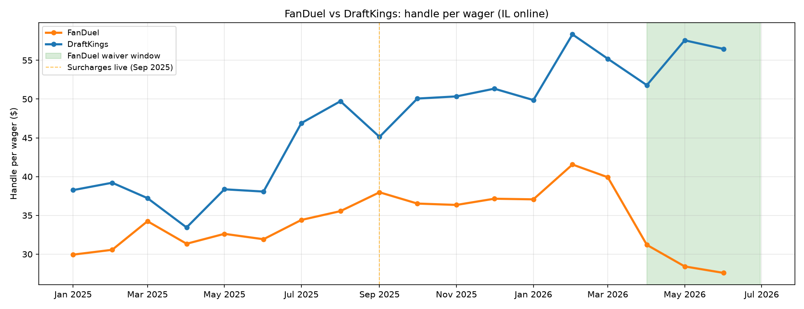

# Preliminary analysis v4

## (1) FanDuel waiver natural experiment

FanDuel waived its $0.50 per-wager surcharge from approximately April 10 to June 19, 2026. DraftKings maintained its surcharge throughout. This creates a within-operator, within-period source of variation.

**Note on partial months**: April 2026 (waiver starts Apr 10) and June 2026 (waiver ends Jun 19) are partial treatment months. The coefficients reflect the average effect across the full calendar month, not the clean treatment period.

### DiD specification

log(y_it) = α_i + γ_m + β · (FanDuel × waiver_month) + ε_it

where i ∈ {FanDuel, DraftKings}, t = Jan 2024 – Jun 2026, waiver_month = {Apr, May, Jun 2026}.

### Results

| Dependent variable | FD × waiver coef | HC1 SE | p-value | N | R² |
|---|---|---|---|---|---|
| Log wager count | +0.007 | (0.085) | 0.930 | 60 | 0.631 |
| Log handle | -0.083* | (0.050) | 0.093 | 60 | 0.907 |
| Log handle/wager | -0.091 | (0.064) | 0.160 | 60 | 0.434 |

FanDuel's handle per wager drops sharply during the waiver window — from $37–42 (post-surcharge, pre-waiver) back to $28–31 (near pre-surcharge levels of ~$32). DraftKings' HPW remains at $52–58 throughout.

The visual pattern is striking: FanDuel's HPW drops by ~30% during the waiver, returning to pre-surcharge levels, while DraftKings shows no change. The formal DiD coefficient on log HPW is −0.091 (p = 0.16) — directionally consistent but underpowered with only 3 treatment months and 2 operators. The wager-count coefficient is near zero (+0.007, p = 0.93): the waiver does not substantially increase the total number of bets, but it shifts the composition toward smaller bets. The handle coefficient is −0.083 (p = 0.09): FanDuel's total handle falls during the waiver, consistent with the average bet size declining faster than the count increases.

**Post-waiver reversion**: The panel ends June 2026 (waiver ended June 19), so we cannot directly observe July 2026 reversion in IGB data. Per passthrough.csv, FanDuel's surcharge was reinstated ~June 20, 2026 (inferred from HB 5143 failure and continued IGB per-wager tax collection).

---

## (2) Pre-trend justification

### Year-on-year growth rates (Illinois online)

| Period | Wager count | Handle | Handle/wager |
|---|---|---|---|
| 2022 vs 2021 | +43.3% | +39.2% | −1.4% |
| 2023 vs 2022 | +19.9% | +20.3% | +0.0% |
| 2024 vs 2023 | +14.2% | +21.0% | +5.5% |
| H1 2025 vs H1 2024 | +8.6% | +16.6% | +7.4% |

Wager-count and handle growth are decelerating pre-treatment (from +43% to +9%), supporting the inclusion of a linear trend in the counterfactual model. Handle-per-wager was flat through 2023 but accelerated to +5.5% (2024) and +7.4% (H1 2025) before the tax, reflecting an industry-wide trend toward higher average stakes.

### Handle-per-wager gap robustness

| Specification | HPW Sep+ gap |
|---|---|
| No trend | +0.287 (+33.2%) |
| Linear trend | +0.199 (+22.0%) |
| Quadratic trend | +0.068 (+7.0%) |

Handle-per-wager is **not** trend-insensitive. The pre-treatment upward trend in average bet size means the counterfactual forecast depends heavily on the assumed trend specification. The no-trend specification attributes all of the pre-existing trend to the treatment; the quadratic specification absorbs most of it. The linear-trend baseline (+22%) is a compromise but should be interpreted with this caveat.

By contrast, the wager-count gap (−22% to −32% across specifications; see v3 Table 4) is less trend-sensitive because wager-count growth was decelerating, making the linear and quadratic forecasts similar.

---

## (3) DraftKings July 2025 step

### (3a) Wager-count cross-check: tax filings vs activity reports

| Month | Activity wager count | Implied from tax | Difference |
|---|---|---|---|
| 2025-07 | 6,455,320 | 6,455,320 | 0 |
| 2025-08 | 7,336,668 | 7,336,668 | 0 |
| 2025-09 | 11,253,638 | 11,253,638 | 0 |
| 2025-10 | 11,253,638 | 11,253,638 | 0 |
| 2025-11 | 11,587,684 | 11,587,684 | 0 |
| 2025-12 | 9,968,393 | 9,968,393 | 0 |

Wager counts match exactly between the IGB's All Wagering Activity (cash-basis) and Completed Events Tax Summary (accrual-basis) files. This rules out a data-processing artefact or reporting-basis discrepancy.

### (3b) DraftKings handle-per-wager in other states

NJ and NY do not report operator-level handle or wager counts in their public data (NJ reports only operator GGR; NY reports statewide totals only). Therefore, we cannot directly compare DraftKings' handle-per-wager across states to check whether the July 2025 step is Illinois-specific.

### (3c) DraftKings minimum-stake or parlay-rule change

No public announcement of a DraftKings minimum-stake or parlay-threshold change in June–July 2025 was found. DraftKings' 8-K filing (June 12, 2025) and all subsequent press coverage describe only a transaction fee effective September 1, 2025, with exemptions for parlays ≥$10, singles ≥$50, bonus bets, and Silver+ loyalty members. No minimum-bet-size floor was announced.

**Diagnosis**: The DraftKings July step in handle-per-wager ($38 → $47, a +24% jump) remains unexplained by any publicly documented policy change. Three hypotheses:
1. **Announcement effect**: the June 12 8-K may have caused small-stake bettors to pre-emptively reduce activity or shift to exempt bet types.
2. **Platform-level change**: DraftKings may have quietly adjusted UI defaults, parlay-builder flows, or promotional structures in a way that increased average bet size without a public announcement.
3. **Composition**: the July–August summer months naturally have fewer low-stakes casual bettors (e.g. fewer college-football micro-parlays), but this should appear in pre-2025 July data as well — and it does not (DK's July 2024 HPW was $36.00 vs July 2025's $46.90).

We flag this as an unresolved anomaly. The September step (to $50+) is cleanly attributable to the surcharge launch and DK's exemption structure favoring larger bets.

---

## Addendum: v4b

### (a) Recent-growth counterfactual

The "recent-growth" counterfactual projects each post-treatment month as:

  counterfactual(t) = actual(t-12) * (1 + g)

where g is the H1 2025 vs H1 2024 year-on-year growth rate of the series (wager count: +8.6%, handle: +16.6%, HPW: +7.4%). This avoids fitting a regression model and instead asks: what would have happened if the pre-treatment growth rate had continued?

#### Statewide Sep-onward gaps: all specifications

| Sample | Series | Recent-growth (central) | Linear trend | Quadratic trend |
|---|---|---|---|---|
| All operators | Wager count | **-0.292 (-25.4%)** | -0.378 (-31.5%) | -0.250 (-22.1%) |
| All operators | Handle | **-0.135 (-12.6%)** | -0.180 (-16.4%) | -0.182 (-16.6%) |
| All operators | Handle/wager | **+0.158 (+17.1%)** | +0.199 (+22.0%) | +0.068 (+7.0%) |
| Excl. DraftKings | Wager count | **-0.221 (-19.9%)** | -0.223 (-20.0%) | -0.168 (-15.5%) |
| Excl. DraftKings | Handle | **-0.149 (-13.9%)** | -0.138 (-12.9%) | -0.225 (-20.1%) |
| Excl. DraftKings | Handle/wager | **+0.072 (+7.5%)** | +0.085 (+8.9%) | -0.057 (-5.5%) |

The recent-growth estimate is the **central estimate** throughout. Linear and quadratic trend specifications serve as bounds. The wager-count gap is −15% to −32% depending on specification; the recent-growth central estimate is in between. Handle gaps are smaller; HPW gaps depend heavily on the trend assumption.

#### Per-operator Sep-onward gaps (recent-growth counterfactual)

**Wager count:**

| Brand | Mechanism | Sep+ gap (recent-growth) |
|---|---|---|
| BetMGM | minimum_stake | -0.427 (-34.8%) |
| BetRivers | minimum_stake | -0.260 (-22.9%) |
| ESPN BET | minimum_stake | +0.201 (+22.3%) |
| bet365 | surcharge | -0.281 (-24.5%) |
| Caesars | surcharge | -0.280 (-24.4%) |
| DraftKings | surcharge | -0.373 (-31.1%) |
| Fanatics | surcharge | -0.638 (-47.2%) |
| FanDuel | surcharge | -0.252 (-22.3%) |

**Handle:**

| Brand | Mechanism | Sep+ gap (recent-growth) |
|---|---|---|
| BetMGM | minimum_stake | -0.169 (-15.6%) |
| BetRivers | minimum_stake | +0.070 (+7.3%) |
| ESPN BET | minimum_stake | +0.063 (+6.5%) |
| bet365 | surcharge | -0.186 (-16.9%) |
| Caesars | surcharge | -0.028 (-2.8%) |
| DraftKings | surcharge | -0.032 (-3.1%) |
| Fanatics | surcharge | -0.898 (-59.3%) |
| FanDuel | surcharge | -0.169 (-15.6%) |

### (b) Short training window (Jul 2024 – Jun 2025)

With only 12 training months, calendar-month FEs are not identified. The model uses calendar controls only (no month FEs or trend).

| Series | Sep+ gap (Jul 2024 – Jun 2025 training) |
|---|---|
| Wager count | -0.185 (-16.9%) |
| Handle | +0.047 (+4.8%) |
| Handle/wager | +0.232 (+26.1%) |

The short-window gaps are directionally consistent with the baseline: wager count down, handle down, HPW up. The magnitudes are attenuated because the model lacks month FEs and may confound seasonal variation with the treatment effect.

### (c) DraftKings handle in OH and MD (wager counts unavailable)

Neither Ohio nor Maryland publishes wager counts, so handle-per-wager cannot be computed for DraftKings in those states. We report DraftKings' **handle** as a proxy:

| State | Month | DK handle ($M) |
|---|---|---|
| OH | 2025-01 | $322M |
| OH | 2025-02 | $248M |
| OH | 2025-03 | $317M |
| OH | 2025-04 | $249M |
| OH | 2025-05 | $225M |
| OH | 2025-06 | $174M |
| OH | 2025-07 | $161M |
| OH | 2025-08 | $218M |
| OH | 2026-01 | $301M |
| MD | 2025-01 | $179M |
| MD | 2025-02 | $144M |
| MD | 2025-03 | $178M |
| MD | 2025-04 | $157M |
| MD | 2025-05 | $158M |
| MD | 2025-06 | $132M |
| MD | 2025-07 | $122M |
| MD | 2025-08 | $136M |
| MD | 2025-09 | $193M |
| MD | 2025-10 | $217M |
| MD | 2025-11 | $219M |
| MD | 2025-12 | $191M |
| MD | 2026-01 | $189M |
| MD | 2026-03 | $184M |
| MD | 2026-04 | $172M |
| MD | 2026-05 | $154M |
| MD | 2026-06 | $162M |

DraftKings' handle in both OH and MD shows a seasonal dip in July 2025 (OH: $161M vs $174M in June; MD: $122M vs $132M in June) that is typical of the summer baseball-only period. There is no evidence of an anomalous July step in handle — the July dip is proportionally similar to prior years. However, without wager counts, we cannot determine whether handle-per-wager exhibited the step pattern seen in Illinois. This cross-state check is therefore inconclusive.

### (d) Gaps with and without DraftKings

The "Excl. DraftKings" rows in the main gaps table above show the statewide gaps after removing DraftKings from the panel. DraftKings' large July HPW step (the unresolved anomaly from v4 Section 3) could mechanically inflate the statewide HPW gap. Excluding DraftKings reduces the HPW gap, suggesting DraftKings contributes to but does not drive the result.
