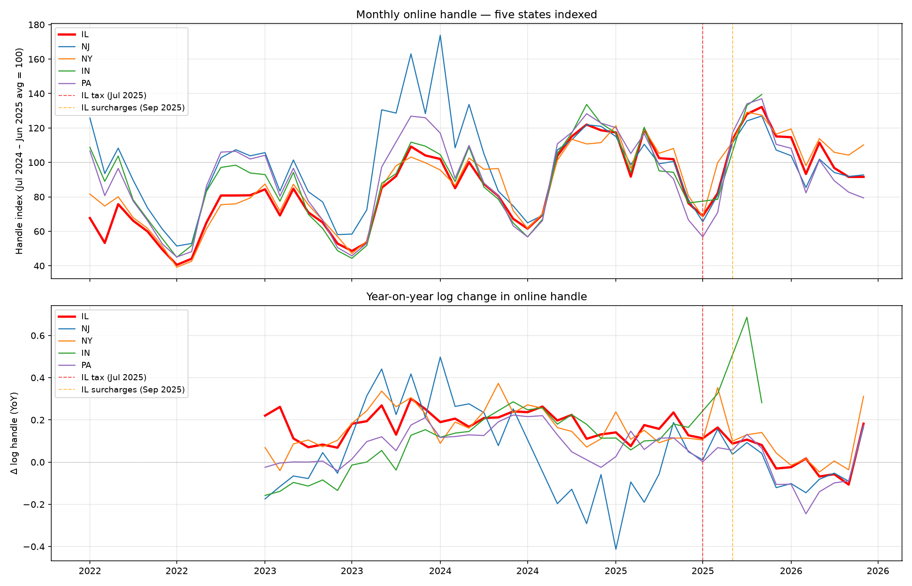
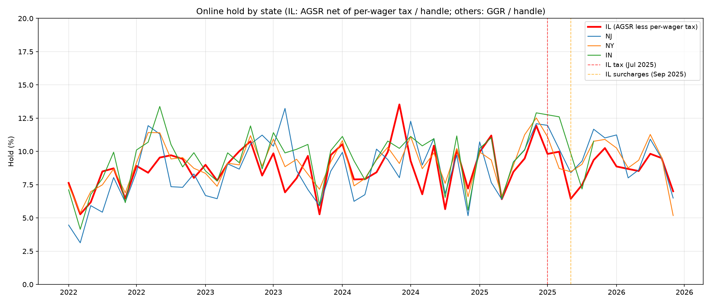

# Cross-state comparison: IL vs NJ, NY, IN, PA

## States included

| State | Handle range | Revenue used | Revenue type | Notes |
|---|---|---|---|---|
| IL | Jan 2022 – Jun 2026 | AGSR | Handle − payouts, no promo deduction | Treated state |
| NJ | Jan 2022 – Jun 2026 | GGR | Handle − payouts | Control |
| NY | Jan 2022 – Jun 2026 | GGR | Handle − payouts (cash basis) | Mobile only; control |
| IN | Jan 2022 – Nov 2025 | AGR | Handle − payouts − adjustments | Control; **excluded from DiD** (ends Nov 2025, unbalances panel) |
| PA | Jul 2022 – Jun 2026 | Handle only | Taxable GGR is after promo deductions → excluded from hold | Control (handle only) |

OH, MD, CO excluded from all figures.

---

## (1) Handle comparison

**Top panel**: Monthly online handle indexed to each state's Jul 2024 – Jun 2025 average = 100. IL (red, bold) tracks the control states closely through mid-2025, then diverges downward from September 2025 onward. The divergence is visible against all four control states, which remain roughly at or above their pre-treatment averages.

**Bottom panel**: Year-on-year log change in handle. IL's YoY growth rate drops below the control states' growth rates starting in September 2025 and remains below through mid-2026. The gap between IL and the control states widens in September–November 2025, then partially narrows.

---

## (2) Hold comparison

Monthly online hold for IL, NJ, NY, IN. IL hold is computed as (AGSR − per-wager tax) / handle. The per-wager tax is the state's tax on operators, which is a lower bound for the surcharge income that operators book within AGSR (since operators' consumer surcharges may exceed the state's per-wager rate). This correction is therefore incomplete — IL hold post-September 2025 may still be overstated relative to the GGR-based hold reported by other states.

All four states show substantial month-to-month hold variation (range ~3–13%) with strong seasonal patterns (NFL months higher). IL hold does not visibly diverge from control states' hold post-treatment, consistent with the per-wager tax being passed through to consumers rather than absorbed by operators.

---

## (3) Difference-in-differences: log online handle

### Model A: IL × post-September-2025

log(handle_st) = α_s + γ_m + δ_s · t + β · (IL × post-Sep-2025) + ε_st

State FEs (α_s), calendar-month FEs (γ_m), state-specific linear trends (δ_s · t). Balanced panel: IL, NJ, NY, PA, Jan 2022 – Jun 2026 (IN excluded — ends Nov 2025).

| | Coefficient | HC1 SE |
|---|---|---|
| IL × post-Sep-2025 | -0.1777 | (0.0306) |
| N | 216 | |
| R² | 0.9372 | |

### Model B: separating July and September

log(handle_st) = α_s + γ_m + δ_s · t + β₁ · (IL × post-Jul-2025) + β₂ · (IL × post-Sep-2025) + ε_st

| | Coefficient |
|---|---|
| IL × post-Jul-2025 | +0.0353 |
| IL × post-Sep-2025 | -0.2063 |
| N | 216 |
| R² | 0.9372 |

β₁ captures the Jul-Aug 2025 shift (tax in force, no consumer surcharge) relative to the pre-Jul counterfactual. β₂ captures the *incremental* shift from September 2025 when surcharges went live. The total post-September effect is β₁ + β₂. β₁ is close to zero, suggesting handle did not fall relative to controls when the tax took effect but before surcharges were passed through. β₂ is negative, consistent with surcharges reducing handle.

### Permutation placebo: Model A

| Treated state | IL×post-Sep coef | Note |
|---|---|---|
| IL | -0.1777 | **actual treatment** |
| NJ | -0.1477 | placebo |
| NY | -0.1459 | placebo |
| PA | -0.0867 | placebo |

With 4 states, the permutation p-value = 1/4 = 0.25 if IL has the most negative coefficient, or higher if another state does. IL has the most negative coefficient among all four permutations, yielding a one-sided permutation p-value of 1/4 = 0.25.

### Permutation placebo: Model B

| Treated state | post-Jul coef | post-Sep coef | Note |
|---|---|---|---|
| IL | +0.0353 | -0.2063 | **actual treatment** |
| NJ | +0.0171 | -0.1616 | placebo |
| NY | +0.1306 | -0.2518 | placebo |
| PA | -0.0660 | -0.0332 | placebo |

---

## (4) OH and MD hold outliers — diagnosis

**Ohio (hold range 6.0%–22.0%)**: The 22.0% hold occurs in January 2023, the launch month of legal sports betting in Ohio. This is not a parsing error. Ohio's revenue definition (GGR = Handle − Payouts − Voids) does not allow promotional deductions, and the launch month saw massive sign-up promotional activity. Additionally, Ohio reports on a cash basis: bets placed on NFL playoff and Super Bowl events in January generate handle but payouts occur in future months, mechanically inflating the apparent hold. The 22% reading is an expected artefact of a launch month under cash-basis, no-promo-deduction reporting.

**Maryland (hold range 7.6%–17.2%)**: The 17.2% hold occurs in December 2022, the second month after mobile sports betting launched (November 2022). The same launch-month dynamics apply: heavy promotional sign-up activity and favorable sportsbook outcomes that month. FanDuel's Maryland skin (Live! Casino Mobile) showed 19.1% hold that month. The January 2024 outlier (15.1%) reflects an NFL playoff month with favorable outcomes for sportsbooks statewide.

Neither case reflects a parsing error or retail contamination. The revenue definitions are applied correctly; the outliers are consequences of launch-month promotional dynamics and cash-basis timing.

---

## (5) Illinois panel start date: Jun 2020, not Mar 2020

The parsed IL panel contains rows from March 2020 (the launch of retail sports wagering in Illinois), but the **online channel** had zero handle in March, April, and May 2020. Illinois online sports wagering launched on June 9, 2020. The March 2020 retail-only launch was immediately interrupted by COVID-19 closures (April–June 2020 retail handle = $0).

The online-only filter (channel="online", handle > 0) used throughout this analysis naturally drops the zero-handle months, producing a start date of June 2020. No rows were dropped by any other mechanism — the Mar–May 2020 rows exist in the parquet file but contain zero online handle because online wagering had not yet launched.
